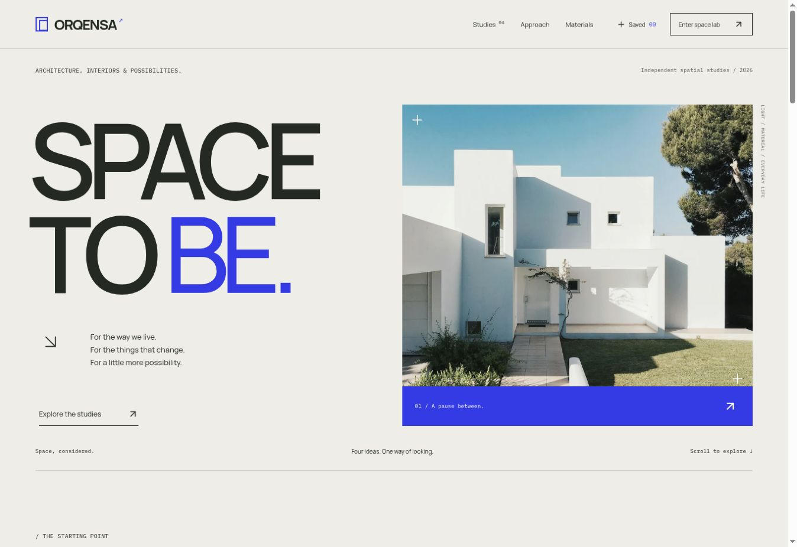

# ORQENSA — Space, considered.

An architecture and interiors concept with an interactive 27 m² space lab. Explore four fictional spatial studies, arrange furniture, compare materials, and turn a room into a downloadable project brief.

[GitHub Pages demo](https://rafayelkaramyan.github.io/orqensa/) · [Implementation](docs/architecture.md) · [Verification status](docs/validation.md) · [Photography credits](docs/assets-and-sources.md)

Design & development: **Rafayel Karamyan**.



Verified release: **37 unit tests + 38 browser scenarios passed** across desktop Chromium, Firefox and mobile Chromium. See the [executed results](docs/validation.md).

## The experience

- An editorial home page, asymmetric study index, four project stories, approach page and material library.
- A shared spatial model behind an interactive SVG plan and a lazy-loaded, isometric 3D view. Furniture supports pointer dragging, keyboard movement, rotation and removal, with 0.1 m snapping and bounds/overlap checks.
- Three floor finishes, three wall/upholstery tones, two lighting directions, and living/work/empty starting layouts.
- Room history with undo/redo, up to 12 saved rooms, independent duplicates, validated JSON import/export, standalone SVG drawings, and portable share snapshots.
- A local brief builder with validation, attached room snapshots, review, text download and print styles. No form submission or account is required.
- Touch-friendly alternatives, route focus, a skip link, native dialogs, reduced-motion support and a persistent motion pause.

The studio and spatial studies are fictional. Licensed photography is used as a visual reference; no architectural commissions, built work or client outcomes are claimed. The plans are illustrative and are not construction documents.

## Run

Node.js **22.12+** or **24** and npm are required.

```sh
npm ci
npm run dev
```

Open the URL printed by Vite. The application uses `/orqensa/` as its base path and hash routes so direct links work on GitHub Pages.

```sh
npm run check       # strict TypeScript, ESLint, formatting, unit tests
npm run build       # production bundle
npm run preview     # serve the production build
npx playwright install --with-deps chromium firefox
npm run test:e2e    # Chromium, Firefox and mobile Chromium
```

The GitHub Actions workflow runs checks and browser tests before publishing `dist/` to GitHub Pages. Repository settings must use **GitHub Actions** as the Pages source. The [verification record](docs/validation.md) records the executed checks, visual review and remaining coverage limits.

## Data and portability

Rooms and briefs are stored in this browser’s local storage. There is no server, account, tracking or synchronization service. A share URL contains an encoded room snapshot, including its title; anyone with the URL can read it. Saving a shared/imported room creates independent identifiers.

Export important rooms as JSON and download briefs to keep a separate copy. Clearing browser data removes the collection. Storage failures do not advance visible saved state; unreadable data can be downloaded before an explicit reset.

Cross-tab changes use a collection generation/revision lease and scene revisions. The Web Locks API serializes cooperating writes where supported. Browsers without Web Locks retain revision checks but cannot guarantee atomic writes between simultaneous tabs. See [tradeoffs](docs/architecture.md#persistence-and-concurrency).

## Stack

React, strict TypeScript, React Router, Vite, Zod, GSAP, React Three Fiber, Three.js, Vitest, Playwright and axe-core. The 3D renderer is an optional enhancement; the SVG plan provides the full editing workflow.

Original application code is under the [MIT License](LICENSE). Photographs and third-party packages retain their [own licenses](docs/licenses.md).
